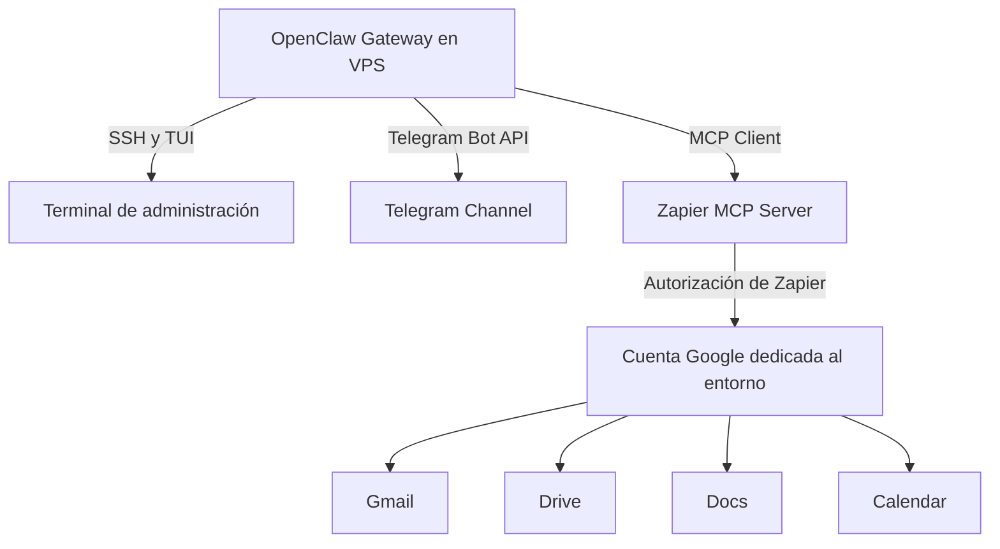

# OPENCLAW ENVIRONMENT TOOLS & INTEGRATIONS

Este documento resume la infraestructura de herramientas, las integraciones MCP y los canales de interacción del entorno OpenClaw alojado en una VPS. Distingue los datos comprobados de las recomendaciones operativas; no contiene credenciales.

---

## 🏗️ RESUMEN DE LA ARQUITECTURA

OpenClaw Gateway se ejecuta en una VPS. Ruth se conecta a la VPS por SSH y desde allí puede ejecutar OpenClaw TUI. Las integraciones de Google están disponibles a través de Zapier MCP.

---

## 🔌 SERVIDORES MCP (MODEL CONTEXT PROTOCOL)

### 1. ZAPIER MCP SERVER
Zapier MCP conecta las acciones de Google autorizadas para este entorno con una **cuenta de Google creada exclusivamente para el agente OpenClaw**, según confirmó Ruth. La autorización se gestiona mediante la conexión de Zapier MCP; no se deben documentar ni copiar credenciales aquí.

*   **Estado:** conectado; verificado consultando las conexiones y acciones habilitadas mediante Zapier MCP.
*   **Autenticación:** conexión autorizada de Zapier MCP. No se ha verificado una API key de Zapier configurada como variable de entorno ni que la autenticación sea corporativa.
*   **Apps conectadas:** Gmail, Google Drive, Google Docs y Google Calendar. Sus acciones disponibles pueden consultarse mediante Zapier MCP; el acceso concreto depende de la acción habilitada y de los permisos de la conexión.
    *   **Google Drive:** Se verificó una búsqueda de solo lectura del documento “Plan de Estudio OpenClaw” en la raíz de Drive.
    *   **Gmail:** El envío de correos externos requiere confirmación explícita de Ruth.
    *   **Google Calendar:** La modificación de eventos existentes requiere confirmación explícita de Ruth.

---

## 🤖 CANALES DE COMUNICACIÓN E INTERFACES

### 1. CANAL DE TELEGRAM (BOT)
Canal bidireccional para la interacción remota con el agente en tiempo real.

*   **Estado:** `CONEXIÓN VERIFICADA`
*   **Capacidad comprobada:** intercambio de consultas y respuestas con el agente en esta conversación.
*   No se documentan alertas proactivas ni transferencias de archivos como capacidades configuradas, porque no se han verificado en este entorno.

### 2. OPENCLAW TUI (TEXT USER INTERFACE)
Interfaz de usuario basada en texto para administración local y debugging.

*   **Acceso:** Ruth confirma que se conecta a la VPS por SSH y desde allí puede ejecutar OpenClaw TUI.
*   **Disponibilidad del proceso TUI:** no comprobada en esta revisión.
*   **Funciones:**
    *   Interacción y administración del agente desde la terminal.
    *   Cuando estén disponibles, consulta del estado del Gateway, registros y llamadas a herramientas. No se describe como acceso a pensamientos internos del agente.

---

## 🛠️ VALIDACIÓN DE CONFIGURACIÓN Y CREDENCIALES

No se mantiene aquí una lista de variables `.env` ni valores de configuración sensibles. Para diagnosticar una integración, valida su estado mediante OpenClaw/Zapier y los mecanismos de autenticación configurados. No pegues ni guardes en este documento tokens, claves, secretos, IDs privados o contenidos de archivos de entorno. La configuración local identifica el servidor Zapier MCP; los detalles de autorización se mantienen fuera de este documento.

---

## 🛡️ SEGURIDAD Y BUENAS PRÁCTICAS EN LA VPS

1. **Privilegios:** En la comprobación del 11 de noviembre de 2026, el proceso Gateway observado se ejecutaba como `root`. No se debe afirmar que corre bajo un usuario sin privilegios. Se recomienda evaluar con el operador una migración a un usuario de servicio dedicado, considerando permisos y configuración antes de cualquier cambio.
2. **Credenciales:** Gestiona y renueva credenciales según el mecanismo de autenticación, las políticas del proveedor y su expiración. No se fija una rotación automática cada 90 días sin una política que lo respalde. Si una credencial se expone, revócala o rótala de inmediato mediante el proveedor.
3. **Persistencia y reinicio:** No se confirmó que el Gateway esté registrado como un servicio systemd activo. Verifica el mecanismo de supervisión y recuperación en el host antes de documentar o modificar políticas de reinicio.
