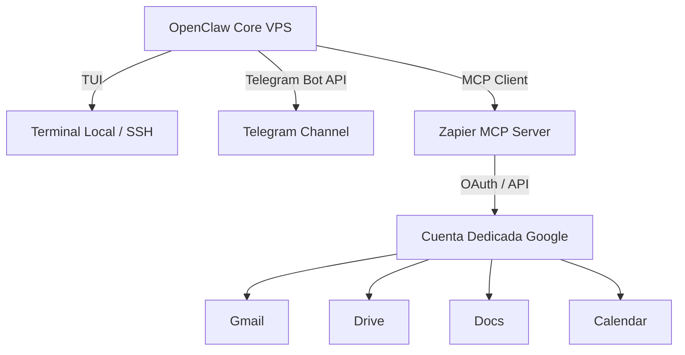

# OPENCLAW ENVIRONMENT TOOLS & INTEGRATIONS

Este documento detalla la infraestructura de herramientas (`Tools`), el Protocolo de Contexto de Modelo (MCP) y los canales de comunicación configurados en el entorno de producción de **OpenClaw** alojado en la VPS exclusiva.

---

## 🏗️ RESUMEN DE LA ARQUITECTURA

OpenClaw opera en una arquitectura desacoplada donde el núcleo del agente se ejecuta en una VPS dedicada, interactuando con servicios externos a través de MCP (Model Context Protocol), webhooks binarios y una interfaz de terminal local (TUI).



---

## 🔌 SERVIDORES MCP (MODEL CONTEXT PROTOCOL)

### 1. ZAPIER MCP SERVER
Para evitar la sobrecarga de gestionar múltiples credenciales OAuth individuales, se utiliza un bridge centralizado a través de Zapier MCP conectado a una **cuenta de Google dedicada**.

*   **Estado:** `CONECTADO`
*   **Autenticación:** API Key de Zapier / OAuth corporativo.
*   **Servicios Disponibles:**
    *   **Google Drive:** Creación, lectura, actualización y listado de archivos o carpetas de proyectos.
    *   **Google Docs:** Generación automática de reportes, minutas de reuniones y lectura de plantillas.
    *   **Gmail:** Monitoreo de bandejas de entrada, filtrado de correos críticos, envío de notificaciones y automatización de respuestas.
    *   **Google Calendar:** Agendamiento de reuniones, verificación de disponibilidad del equipo y alertas de eventos.

---

## 🤖 CANALES DE COMUNICACIÓN E INTERFACES

### 1. CANAL DE TELEGRAM (BOT)
Canal bidireccional para la interacción remota con el agente en tiempo real.

*   **Estado:** `CONEXIÓN VERIFICADA`
*   **Capacidades:**
    *   Recepción de comandos y consultas en lenguaje natural.
    *   Envío de alertas proactivas ante eventos del sistema o notificaciones de Gmail/Calendar.
    *   Soporte para carga y descarga de archivos procesados (PDFs, imágenes, etc.).

### 2. OPENCLAW TUI (TEXT USER INTERFACE)
Interfaz de usuario basada en texto para administración local y debugging.

*   **Estado:** `ACTIVO`
*   **Uso:** Acceso directo desde la terminal de la VPS vía SSH.
*   **Funciones:**
    *   Monitoreo en tiempo real del flujo de pensamiento del agente (`Agent Thoughts`).
    *   Inspección de llamadas a herramientas (Logs de herramientas de Zapier y Telegram).
    *   Control manual del ciclo de vida del agente.

---

## 🛠️ CONFIGURACIÓN DEL ENTORNO (VARIABLES DE ENTORNO CLAVE)

Asegúrate de que el archivo `.env` en la raíz de la VPS contenga las siguientes directrices activas para que estas herramientas funcionen:

```env
# --- OPENCLAW CORE ---
OPENCLAW_ENV=production
OPENCLAW_TUI_ENABLED=true

# --- TELEGRAM CONFIG ---
TELEGRAM_BOT_TOKEN=out_of_workspace_for_security
TELEGRAM_ALLOWED_CHAT_IDS=[123456789example,987654321example]

# --- MCP ZAPIER / GOOGLE CONFIG ---
ZAPIER_MCP_API_KEY=out_of_workspace_for_security
GOOGLE_DEDICATED_ACCOUNT=ruthcarol2810.academy@gmail.com
```

---

## 🛡️ SEGURIDAD Y BUENAS PRÁCTICAS EN LA VPP

1. **Aislamiento de Procesos:** OpenClaw y el TUI se ejecutan bajo un usuario del sistema sin privilegios de root (`openclaw-user`).
2. **Rotación de Credenciales:** Los tokens de Telegram y las llaves de Zapier MCP deben ser rotados cada 90 días.
3. **Persistencia:** El agente está configurado como un servicio de sistema (`systemd`) para garantizar su reinicio automático si la TUI o el proceso principal se interrumpen.
